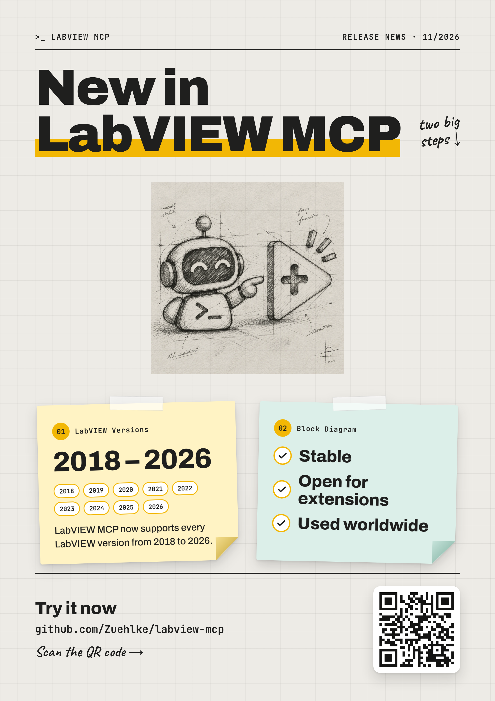

# Announcements

Release news, posters and conference material. This folder sits outside `docs/` on purpose:
everything under `docs/` is copied next to the exe and into every release archive, and none of
this is needed at run time.

Name a release announcement after its tag (`vX.Y.Z-<what>.<ext>`), so it can be traced to the
release it describes. A new poster is rendered from [`template/`](template/), which also keeps
each poster's JSON source.

| Release / event | Date | Material |
|---|---|---|
| `v2.4.5` | 2026-11-05 | Poster "New in LabVIEW MCP": LabVIEW 2018-2026 supported; block diagram stable and open for extensions ([PNG](v2.4.5-poster.png), [PDF](v2.4.5-poster.pdf)) |
| GDevCon #7 | 2026-09 | Talk slides, screenshots and a demo video ([`gdevcon7/`](gdevcon7/)) |

