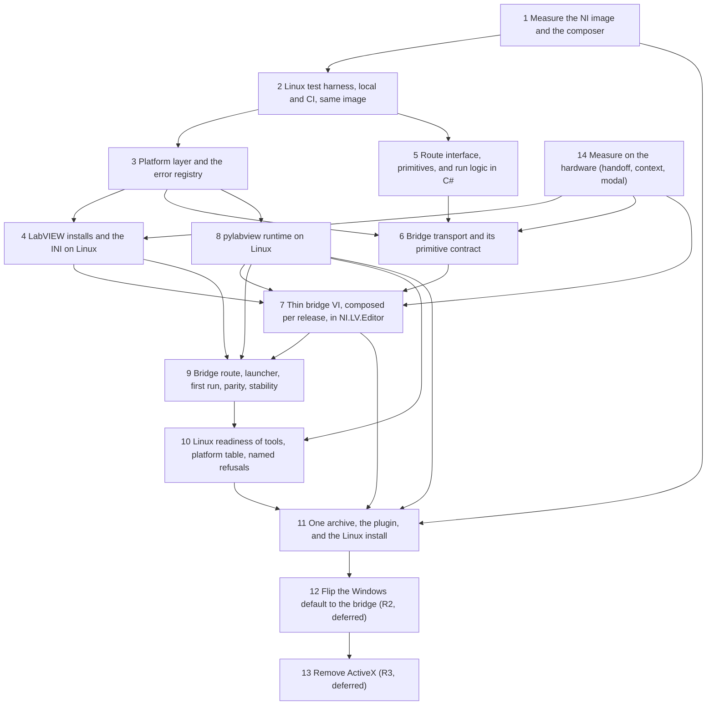

# Plan: Cross-platform LabVIEW MCP server (Windows and Linux, Mac-ready)

**Created**: 2026-11-09 (revision 3: review iteration 2 findings applied, not re-reviewed)
**Branch**: main (build on `feat/xplat-<slice>` branches, one PR per slice)
**Status**: approved (2026-11-09, by the user); revision 4 (available hardware) approved (2026-11-09, by the user). Tracking: this file only, no GitHub issues (the user's decision)
**Spec**: `docs/specs/cross-platform-server.md`
**Gherkin persistence**: plan-file-only

## Goal

Make one codebase serve Windows and Linux users with the same tools. A G-CLI-style bridge replaces
ActiveX on every OS. The server writes one owner-only rendezvous file per connection, and a thin
bridge VI connects back over loopback TCP. The bridge VI does basic VI Server calls only. The run
logic is written once in C# for both routes. The bridge VI is composed per running LabVIEW release,
and it runs in the `NI.LV.Editor` context, never in the Main Application Instance. Linux gets its own
pylabview runtime and platform code paths. One `labview-mcp.zip` ships both OS builds. The NI Linux
image is the development loop on this Mac and the CI environment. The `grpc` backend is out of
scope, and macOS is compile-only.

### Development loop

Slice 1 measures the NI image on this Mac. Slice 2 turns it into the harness that every later slice
uses. Each step's TEST runs `scripts/Test-Linux.ps1` locally before commit, and the PR's CI job runs
the same script on the same pinned image. A step is green only when both pass, together with the
Windows gate (`pwsh -File .githooks/run-tests.ps1`) and the `tools/list` snapshot. The default gates
exclude tests tagged `RequiresLabVIEWStation`, which need a LabVIEW display or the Windows station. A
slice with such tests is done only when `scripts/Assert-StationRecord.ps1` finds its record in
`docs/measurements/slice-<N>.md`, with date, LabVIEW build, and bitness.

### Release shape

| Release | Contains | Gate |
|---|---|---|
| R1: Linux and bridge opt-in | Slices 1 to 11 and 14. Linux ships here, with everything working (the user's "all at once"). On Windows, `auto` stays ActiveX and the bridge is opt-in. | AC1 to AC13, AC15 to AC18, AC20, and the short AC19 run (10 000 operations, 4 lanes) on both OS |
| R2: Windows default flip (deferred) | Slice 12, built only after R1 has been in use for one release | The full AC19 |
| R3: ActiveX removal (deferred) | Slice 13, built only in a release after R2 | AC14 |

Slices merge to `main` one PR at a time. No release is tagged before Slice 11 is done.

### Approach stances (high-reversal-cost axes)

| Axis | Stance |
|---|---|
| Replace vs. merge | Expand, then contract, in three releases (table above). ActiveX is deleted only in R3. |
| Scope | Not in this plan: the `grpc` backend (neither ported nor removed), a macOS runtime, Docker for users, distros outside NI's support list, a per-call route argument, and add-on packages (Caraya, LUnit, VI Tester, DQMH, LMock) until measured on Linux. Unmeasured add-on tools refuse by name. |
| Integration | One PR per slice, merged on green checks. No direct pushes to `main`. |
| Format fidelity | Windows tool names, schemas, and messages stay byte-identical, except for the fields in "Intended Windows answer changes" below, which a test enforces. The archive name, URL, and version stamping keep their format. |
| Dependency | The G-CLI pattern is copied. G-CLI and NI Service Locator are not dependencies. |

### Intended Windows answer changes

| Field | Where | Step |
|---|---|---|
| `nextStep`, `retryable` | Added to error answers whose kind is in the registry. The legacy `message` text is unchanged. | 3.4 |
| `route`, `routeSource`, `bridgeStartedNow` | Only on answers served by the bridge route. Windows default (ActiveX) answers are unchanged in R1. | 9.1, 9.2 |
| `platform` block | `lvai_status` only | 9.3, 10.3 |

`WindowsAnswerFieldsTests` (Step 3.4) compares committed Windows answers of three tools with the live
answers, and fails on any field not in this table.

### Shared station rule

Steps that use LabVIEW on the Windows station or the Linux desktop own that machine for the whole
step: 1.2, 5.x, 7.x, 9.2, 9.4, 12.1, 13.1, and 14.x. They never run beside each other, following
`CLAUDE.md`. Each slice's gate runs in its own worktree, so it cannot stop an `lvai` server used by
another agent. `scripts/Test-Linux.ps1` gives each worktree its own container name and mount, uses no
fixed host ports, and removes its container on exit, so parallel slices can share one Docker daemon.

## Acceptance Criteria

- [ ] AC1: On every PR, CI publishes `linux-x64` (self-contained, single file, not trimmed), and the binary answers `--version`.
- [ ] AC2: On every PR, CI compiles `osx-arm64`. `PlatformScanTests` fails on any `!OperatingSystem.IsWindows()` and on any `else` after an OS check that has no named allow-list entry. CS8509 is an error in the build, so a switch over `Platform.Current` has no default arm.
- [ ] AC3: Windows bridge answers equal the committed ActiveX goldens for Windows LabVIEW 2026 64-bit, after the normaliser whose rules are listed in `tests/LabVIEWMCP.Tests/Fixtures/Bridge/README.md`. `DocMarkerTests` fails if `README.md` or the platform support table lacks the unmeasured note for Windows 2020 to 2025 and 32-bit.
- [ ] AC4: Every operation not in `headless-skip.tsv` passes in the NI image, locally and in CI. Each skip row has a reason. Every skip row passes in a run on the Pop!_OS laptop, recorded in `docs/measurements/slice-9.md`.
- [ ] AC5: With no LabVIEW running, a bridge-route tool answers `labviewNotRunning`, and the LabVIEW process count is unchanged on both OS.
- [ ] AC6: Production deadlines are named constants: first connect after launch 15 s, background reconnect probe 500 ms. Tests inject scaled deadlines. Each of `bridgeNotConnected`, `bridgeStopped`, `labviewGone`, `labviewNotAnswering`, and `bridgeFramingError` returns its own `errorKind` with a `nextStep`, and the next call recovers.
- [ ] AC7: A connection with a bad or replayed token is closed and logged. A silent connection is closed after the handshake timeout and logged. On Linux the rendezvous file and its directory are mode 0600/0700 at creation; on Windows their ACL grants only the current user. One file per connection. The token never appears in logs or answers. The listener binds loopback only.
- [ ] AC8: On Linux, each tool the platform support table marks supported returns an answer that is not `notSupportedOnPlatform` and raises no exception. Each other tool refuses by name. The test pins the supported count, and the drift test covers every tool.
- [ ] AC9: With no system Python, pylabview runs from `runtime/linux-x64`. The composed AIXML equals the Windows reader's golden, and `lvai_generate_vi` writes an executable VI in the NI image.
- [ ] AC10: One archive with both binaries, both runtimes, the bridge AIXML, and execute bits. One identical `.mcp.json` starts the server on both OS in CI. The archive is at most 2.2 times the size in `scripts/archive-baseline.txt`.
- [ ] AC11: The read-only tool list is generated once into `plugin/hooks/readonly-tools.txt` and used by both hooks. On Linux the hook allows those tools; any missing dependency or malformed stdin answers `ask` with a reason. The guard is silent on Linux and warns on macOS with the text in `plugin/hooks/macos-notice.txt`.
- [ ] AC12: Settings and cache live under `$HOME/.labviewmcp`. The INI's bytes and mtime are unchanged after every test. A missing INI, a `HOME` that is not writable, and a LabVIEW that is too old each answer as specified.
- [ ] AC13: From Slice 2 on, the `tools/list` snapshot, `WindowsAnswerFieldsTests`, and the Windows gate pass after every slice.
- [ ] AC14: At the R2 tag, `Assert-SoakRecord` passes and `auto` resolves to the bridge on Windows. At the R3 tag, `NoActiveXTests` and `DocMarkerTests` pass.
- [ ] AC15: Each slice PR adds `docs/measurements/slice-N.md` with one row per check, failures included. `Assert-StationRecord` fails on a missing row. That `CLAUDE.md` and the orchestrator brief stay in step is a reviewer check.
- [ ] AC16: One local command runs the Linux suite and writes the counts file (passed, failed, skipped). CI fails if its counts for the same commit differ.
- [ ] AC17: Every new `errorKind` has a non-empty `nextStep` (one imperative sentence ending in a period, linted) and a `retryable` flag. The scan finds every `errorKind` literal in the registry or the legacy allow-list, and the docs table is generated from the registry.
- [ ] AC18: In 20 simultaneous two-server starts on one LabVIEW, each server reaches its own stub, with 0 mismatches, recorded in `docs/measurements/slice-14.md`. With two servers connected, 4 lanes keep working.
- [ ] AC19: The short run (10 000 consecutive operations in total over 4 parallel lanes, 0 transport failures) gates R1 on both OS. A transport failure is one of the five AC6 kinds. The 8 h idle check and one opt-in release with no open `bridge-stability` issue gate R2.
- [ ] AC20: During the AC19 run and after the session, `All VIs In Memory` of the main instance and of every open project's instance lists no bridge VI or subVI. A fixture VI running in an open project finishes with no abort and no error.
- [ ] AC21: `labviewRoute` resolves by `--labview-route`, then `LABVIEWMCP_LABVIEW_ROUTE`, then the settings file. On the bridge, a broken VI answers `viBroken` and is not run; a run past its deadline is aborted. A server stop ends its bridge clone and leaves LabVIEW running. LabVIEW asks to save nothing of ours.

## Slices

### Slice 1: Measure the NI image and the composer

**Depends-on:** none
**Files:** `docs/measurements/slice-1.md`, `experiments/linux-bridge/**`
**Rollback point:** slice-start

This slice needs only this Mac, the container, and the Windows station (LabVIEW 2026 64-bit) for the composer check.
It records real transcripts, which later slices use as fixtures. If an assumption fails, the plan
stops and returns to `/specs`. Startup threshold: if LabVIEW in the container takes more than
5 minutes to start, or the 100-echo run fails under emulation, local runs cover unit tests only, and
container-tagged tests run in CI only.

**Behavior:**

```gherkin
Feature: The NI image and the composer can carry the bridge

  Scenario: The NI image runs on this Mac
    Given Docker on this Apple Silicon Mac
    When the pinned NI LabVIEW for Linux image is started with platform linux/amd64
    Then LabVIEWCLI reports the LabVIEW version, and the startup time is recorded

  Scenario Outline: The bridge skeleton composes and loads
    Given a bridge skeleton composed by pylabview for <release>, using a reentrant TCP loop, Open Application Reference, Open VI Reference in another context, property and invoke nodes, and control get and set as LabVIEW XML
    When <release> opens it
    Then it is executable and makes one loopback round trip

    Examples:
      | release                       |
      | LabVIEW 2026 Windows 64-bit   |
      | LabVIEW 2026 Q1 Linux         |

  Scenario Outline: A resident skeleton in the headless container
    Given the NI image with no display
    When the skeleton is started by <route>
    Then it answers 100 echo requests with 0 failures

    Examples:
      | route              |
      | labview launch     |
      | LabVIEWCLI RunVI   |

  Scenario Outline: VI Server and VI Scripting work on Linux
    Given LabVIEW 2026 Q1 for Linux in the NI image
    When the skeleton calls <method> on a fixture VI
    Then the call returns without error

    Examples:
      | method             |
      | Open VI Reference  |
      | Execution State    |
      | Run VI async       |
      | Abort VI           |
      | Print VI To HTML   |
      | SubVI Replace      |
      | Remove Bad Wires   |
      | Clean Up Diagram   |
```

**Steps:**

#### Step 1.1: The NI image on this Mac, and VI Server in it

**Complexity**: standard
**IMPLEMENT**: Write `probe-container.sh`. It starts the pinned image (`2026q1-linux` or later, recorded by digest) with `--platform linux/amd64`, then runs LabVIEWCLI and the method table.
**TEST**: Record per-method pass or fail, startup time, and error text. Pass condition: every row is recorded, and every passing row has a transcript.
**REFACTOR**: Fold the container setup into one helper that Slice 2 reuses.
**Files**: `experiments/linux-bridge/probe-container.sh`, `docs/measurements/slice-1.md`
**Commit**: `docs(measure): NI LabVIEW for Linux image on Apple Silicon, VI Server and Scripting`

#### Step 1.2: Bridge skeleton through the composer

**Complexity**: complex
**IMPLEMENT**: Author the bridge skeleton as AIXML, with every construct the thin bridge needs. Compose it for LabVIEW 2026 64-bit (Windows) and 2026 Q1 (Linux), and for 2020 as an offline read-back only. Start it in the container by both routes.
**TEST**: The skeleton and resident scenarios. Transcripts are saved under `experiments/linux-bridge/transcripts/`.
**REFACTOR**: Keep both route results. Drop only the skeleton code that a route does not need.
**Files**: `experiments/linux-bridge/skeleton.aixml`, `experiments/linux-bridge/probe-resident.sh`, `experiments/linux-bridge/transcripts/`, `docs/measurements/slice-1.md`
**Commit**: `docs(measure): composed bridge skeleton across releases and in headless LabVIEW`

### Slice 14: Measure on the hardware (handoff, context, modal)

**Depends-on:** none
**Files:** `docs/measurements/slice-14.md`, `experiments/linux-bridge-hw/**`
**Rollback point:** slice-start

It is numbered 14 to keep the other slice numbers stable. It runs in parallel with Slices 1 to 3 and
5, so the hardware does not hold up the harness or the interface extraction. Slices 4, 6, and 7
depend on it. Each step runs on this matrix:

| Machine | LabVIEW |
|---|---|
| Windows station (the user's laptop) | 2026 64-bit |
| Linux desktop (the user's Pop!_OS laptop) | LabVIEW for Linux 2026 Q1 64-bit (stated by the user); Step 14.1 records the exact build |

Windows 2020 to 2025, Windows 32-bit, and side-by-side installs have no machine. They ship unmeasured,
and the docs say so (the user's decision of 2026-11-09).

**Behavior:**

```gherkin
Feature: The facts that need real LabVIEW installs

  Scenario Outline: A VI handed to a running LabVIEW opens in that instance
    Given exactly one process of the LabVIEW binary runs on <machine>
    When the LabVIEW binary is launched with the probe VI path
    Then the probe runs in the existing process
    And the count of processes of that LabVIEW binary is still one

    Examples:
      | machine                                  |
      | Linux desktop, 2026 Q1                   |
      | Windows, each release in the matrix      |

  Scenario Outline: The probe finds its own rendezvous file
    Given the server side wrote one owner-only rendezvous file for this connection
    When the probe starts in a handed-off instance by <mechanism>
    Then it reads the port and token from its own file

    Examples:
      | mechanism                                     |
      | launch argument                               |
      | nonce in the path of the composed stub VI     |

  Scenario: Two servers start at the same moment
    Given two servers each write a rendezvous file and launch a stub at the same time
    When both stubs start
    Then each connection is made by the stub started for that server

  Scenario Outline: The probe runs in the editor context
    Given a user project is open and running in <release>
    When a stub in the Main Application Instance starts the probe in NI.LV.Editor and exits
    Then the probe reports its context name as NI.LV.Editor
    And All VIs In Memory of the main instance and of the project's instance contain none of our VIs
    And from NI.LV.Editor the probe opens a fixture VI in the main instance and in the project's instance
    And a second stub starts a second probe clone, and both answer

    Examples:
      | release                       |
      | each release in the matrix    |

  Scenario Outline: A modal dialog in LabVIEW
    Given the probe is connected and <release> shows a modal dialog
    When the server sends an echo request
    Then the result, answered or blocked, and the time are recorded

    Examples:
      | release                       |
      | each release in the matrix    |
```

**Steps:**

#### Step 14.1: Handoff and rendezvous

**Complexity**: standard
**IMPLEMENT**: Launch the probe while LabVIEW runs, on every matrix row. Count processes of that LabVIEW binary before and after. Try both rendezvous mechanisms and the two-servers race. On Linux, record the INI path, the NI install root, and the LabVIEW process name.
**TEST**: Record the counts, the working mechanism, and the paths per row.
**REFACTOR**: Write a summary table at the top of the measurement document.
**Files**: `experiments/linux-bridge-hw/stub.aixml`, `docs/measurements/slice-14.md`
**Commit**: `docs(measure): instance handoff and rendezvous on Linux and Windows`

#### Step 14.2: The `NI.LV.Editor` context

**Complexity**: complex
**IMPLEMENT**: Find how a stub in the main instance starts the probe in `NI.LV.Editor` and leaves nothing behind, on every matrix row. Check access to the main instance and a project's instance, and two bridge clones in one LabVIEW.
**TEST**: The editor-context outline, with `All VIs In Memory` dumps of every instance saved as fixtures.
**REFACTOR**: Write the working recipe as a numbered procedure.
**Files**: `experiments/linux-bridge-hw/context-stub.aixml`, `docs/measurements/slice-14.md`
**Commit**: `docs(measure): bridge in NI.LV.Editor, targets in main and project instances`

#### Step 14.3: Modal dialog behavior

**Complexity**: standard
**IMPLEMENT**: With the probe connected, open a modal dialog and send echo requests, on every matrix row.
**TEST**: Record whether it answers or blocks, and for how long. Write the resulting `labviewNotAnswering` hint text as a constant for Slice 6.
**REFACTOR**: Note the consequence for window titles on Linux.
**Files**: `docs/measurements/slice-14.md`
**Commit**: `docs(measure): bridge behaviour behind a LabVIEW modal dialog`

### Slice 2: Linux test harness, local and CI, same image

**Depends-on:** 1
**Files:** `scripts/Test-Linux.ps1`, `scripts/Assert-StationRecord.ps1`, `scripts/linux-image.txt`, `.github/workflows/linux-ci.yml`, `.githooks/run-tests.ps1`, `build.ps1`, `tests/LabVIEWMCP.Tests/**`, `docs/measurements/slice-2.md`
**Invariants:** `pwsh -File .githooks/run-tests.ps1`

Edits to existing tests in this slice add skip attributes only.

**Behavior:**

```gherkin
Feature: Every slice is tested on Linux locally and in CI with the same image

  Scenario: One local command runs the Linux suite
    Given Docker runs on the developer's machine, including this Apple Silicon Mac
    When the developer runs scripts/Test-Linux.ps1
    Then the unit tests and the container-tagged tests run in the pinned NI image
    And a counts file with passed, failed, and skipped counts is written

  Scenario: CI compares its counts with the local counts file
    Given a counts file committed for the commit under test
    When the CI job runs the same script
    Then the job fails if its counts differ from the file

  Scenario: Two worktrees run at once
    Given two worktrees run scripts/Test-Linux.ps1 at the same time
    When both finish
    Then both report counts, and no container from either run is left

  Scenario: Docker is not running
    Given Docker is not running
    When the developer runs scripts/Test-Linux.ps1
    Then it exits non-zero and says Docker is not running

  Scenario: A skip without a reason fails
    Given a test is skipped on Linux without a reason string
    When the test suite runs
    Then the harness test fails and names that test

  Scenario: An unnamed OS branch fails
    Given a source file selects Linux behavior with !OperatingSystem.IsWindows()
    When the platform scan test runs
    Then it fails and names the file and line

  Scenario: The Windows tool surface is unchanged
    Given the tools/list snapshot committed before this work
    When the server answers tools/list
    Then names, descriptions, and input schemas equal the snapshot

  Scenario: A station test without a record blocks the slice
    Given a slice has a RequiresLabVIEWStation test and no entry in its measurement file
    When Assert-StationRecord runs
    Then it fails and names the test

  Scenario: Cross builds on every pull request
    When the PR workflow runs
    Then linux-x64 publishes and answers --version
    And osx-arm64 compiles
```

**Steps:**

#### Step 2.1: Test gate under `pwsh` on Linux, skip reasons, station records

**Complexity**: standard
**IMPLEMENT**: `run-tests.ps1` and `build.ps1` run under `pwsh` on both OS. The default gate excludes `RequiresLabVIEWStation`. Add `[WindowsOnly("reason")]`, tag every existing Windows-only test with a reason, and add the reflection test. Add `Assert-StationRecord.ps1`.
**TEST**: On Linux, the test count equals passed plus skipped-with-reason. The reflection test fails on a planted reason-less skip, and the record script fails on a planted missing record.
**REFACTOR**: One entry point per script, never a second Linux copy.
**Files**: `.githooks/run-tests.ps1`, `build.ps1`, `scripts/Assert-StationRecord.ps1`, `tests/LabVIEWMCP.Tests/**`
**Commit**: `build: test gate under PowerShell 7 on Linux, skips need a reason`

#### Step 2.2: `tools/list` snapshot and the platform scan

**Complexity**: standard
**IMPLEMENT**: Commit the snapshot from the current `main`, and add its test. Add the source scan for `!IsWindows()`, with a reasoned allow-list. Treat CS8509 as an error, so switches over `Platform.Current` need every OS arm.
**TEST**: The snapshot test fails on a renamed tool and a changed schema. The scan fails on a planted `!IsWindows()`.
**REFACTOR**: One normaliser for snapshot ordering.
**Files**: `tests/LabVIEWMCP.Tests/Snapshots/tools-list.json`, `tests/LabVIEWMCP.Tests/Harness/ToolsListSnapshotTests.cs`, `tests/LabVIEWMCP.Tests/Harness/PlatformScanTests.cs`, `tests/LabVIEWMCP.Tests/Harness/SkipReasonTests.cs`
**Commit**: `test: tools/list snapshot and a scan for unnamed OS branches`

#### Step 2.3: `scripts/Test-Linux.ps1`

**Complexity**: standard
**IMPLEMENT**: Cross-publish `linux-x64` on the host and mount the binary, so no .NET build runs under emulation. Start LabVIEW in the container (the harness starts it, never the server). Run the unit tests and the container-tagged tests with a timing scale factor (`LABVIEWMCP_TEST_TIME_SCALE`). Use a per-worktree container name and no fixed host ports, remove the container on exit, and write the counts file.
**TEST**: The local-run, two-worktrees, and Docker-stopped scenarios on this Mac.
**REFACTOR**: Keep the image digest in `scripts/linux-image.txt`. Document the command in `docs/measurements/slice-2.md`.
**Files**: `scripts/Test-Linux.ps1`, `scripts/linux-image.txt`, `docs/measurements/slice-2.md`
**Commit**: `test: run the Linux suite locally in NI's LabVIEW container`

#### Step 2.4: PR workflow

**Complexity**: standard
**IMPLEMENT**: `linux-ci.yml` runs `scripts/Test-Linux.ps1` on `ubuntu-latest` and compares the counts file. It also runs the `linux-x64` publish with a `--version` smoke check, and an `osx-arm64` compile.
**TEST**: Green on a PR branch, and the counts comparison fails on a planted difference.
**REFACTOR**: Read the image digest from `scripts/linux-image.txt`.
**Files**: `.github/workflows/linux-ci.yml`
**Commit**: `ci: Linux tests in NI's LabVIEW image, cross builds on every PR`

### Slice 3: Platform layer and the error registry

**Depends-on:** 2
**Files:** `docs/platform-audit.md`, `src/LabVIEWMCP/Infra/Platform.cs`, `src/LabVIEWMCP/Infra/LabViewMachine.cs`, `src/LabVIEWMCP/Infra/LinuxLabViewMachine.cs`, `src/LabVIEWMCP/Infra/LabViewWindow.cs`, `src/LabVIEWMCP/Infra/ProcessCommandLine.cs`, `src/LabVIEWMCP/Infra/ServerSettings.cs`, `src/LabVIEWMCP/Infra/CacheDirectory.cs`, `src/LabVIEWMCP/Infra/ErrorKinds.cs`, `src/LabVIEWMCP/Infra/ErrorKinds.Platform.cs`, `src/LabVIEWMCP/Infra/Json.cs`, `tests/LabVIEWMCP.Tests/Infra/PlatformTests.cs`, `tests/LabVIEWMCP.Tests/Infra/ErrorKindsTests.cs`, `tests/LabVIEWMCP.Tests/Harness/WindowsAnswerFieldsTests.cs`, `tests/LabVIEWMCP.Tests/Fixtures/WindowsAnswers/**`
**Invariants:** `pwsh -File .githooks/run-tests.ps1`, `pwsh -File scripts/Test-Linux.ps1`

**Behavior:**

```gherkin
Feature: The server finds its files and LabVIEW processes on each OS

  Scenario Outline: Settings and cache live in the user's home folder
    Given the server runs on <os>
    When it resolves its settings file
    Then the path is <home>/.labviewmcp/settings.json

    Examples:
      | os      | home          |
      | Windows | %USERPROFILE% |
      | Linux   | $HOME         |

  Scenario: HOME is not writable on Linux
    Given HOME is unset or read-only
    When the server resolves its settings
    Then it answers settingsPathUnavailable naming the path, with a nextStep

  Scenario Outline: A running LabVIEW is recognised
    Given a process of the LabVIEW binary runs on <os>
    When the server checks whether LabVIEW runs
    Then the answer is yes and names the process id

    Examples:
      | os      |
      | Windows |
      | Linux   |

  Scenario: macOS gets a named refusal
    Given the OS is injected as macOS
    When lvai_list_labview_installations is called
    Then it answers notSupportedOnPlatform with the shared macOS text

  Scenario: Error kinds carry guidance
    Given an errorKind in the registry
    When an error answer with that kind is written
    Then it carries nextStep and retryable, and its message text is unchanged

  Scenario: Every errorKind literal is accounted for
    When the scan reads every errorKind literal in src/
    Then each is a registry key or in the legacy allow-list

  Scenario: Windows answers change only as listed
    Given the committed Windows answers of three tools
    When the live Windows answers are compared with them
    Then any field not in the "Intended Windows answer changes" table fails the test
```

**Steps:**

#### Step 3.1: Windows-assumption audit

**Complexity**: standard
**IMPLEMENT**: Grep `src/` for `DllImport`, `Registry`, `OperatingSystem`, `USERPROFILE`, `.exe`, `.cmd`, `powershell`, `"LabVIEW"`, backslash literals, and literal `Path.Combine`. Commit a table with file, assumption, Linux decision (port, refuse with component, or Windows-only), and owning slice. Rows that no other slice owns go to Step 10.1.
**TEST**: A test fails if a scan hit is in a file the table does not list.
**REFACTOR**: Group the rows by owning slice.
**Files**: `docs/platform-audit.md`, `tests/LabVIEWMCP.Tests/Infra/PlatformTests.cs`
**Commit**: `docs(platform): audit of Windows assumptions with a Linux decision per file`

#### Step 3.2: `Platform` and `LinuxLabViewMachine`

**Complexity**: standard
**IMPLEMENT**: Add `Platform.Current` and `Platform.Refuse(component)`, with the shared macOS text. Extend `ILabViewMachine` with `RunningPids`, `AnyGone`, and `VisibleWindowTitles`. Add `LinuxLabViewMachine`, reading `/proc` and using the measured process name, with one factory. The old static entry points of `LabViewMachine`, `LabViewWindow`, and `ProcessCommandLine` stay as forwarders, so no caller changes in this slice. Win32 classes keep `[SupportedOSPlatform("windows")]`.
**TEST**: Tests with injected OS and process lists for every branch. The CA1416 build stays warning-free.
**REFACTOR**: Remove duplicated Win32 declarations inside the touched files only.
**Files**: `src/LabVIEWMCP/Infra/Platform.cs`, `src/LabVIEWMCP/Infra/LabViewMachine.cs`, `src/LabVIEWMCP/Infra/LinuxLabViewMachine.cs`, `src/LabVIEWMCP/Infra/LabViewWindow.cs`, `src/LabVIEWMCP/Infra/ProcessCommandLine.cs`, `tests/LabVIEWMCP.Tests/Infra/PlatformTests.cs`
**Commit**: `feat(platform): Linux implementation of ILabViewMachine, named macOS refusal`

#### Step 3.3: Settings and cache paths

**Complexity**: standard
**IMPLEMENT**: Resolve the home folder through `Platform`. Windows message text stays byte-identical, and Linux messages name the resolved path.
**TEST**: Path tests for both OS, the not-writable case, and the existing `setDefaultDone` migration test on both OS.
**REFACTOR**: One home-folder helper shared by settings and cache.
**Files**: `src/LabVIEWMCP/Infra/ServerSettings.cs`, `src/LabVIEWMCP/Infra/CacheDirectory.cs`, `tests/LabVIEWMCP.Tests/Infra/PlatformTests.cs`
**Commit**: `feat(platform): settings and cache under the home folder on Linux`

#### Step 3.4: Error registry and the Windows answer check

**Complexity**: standard
**IMPLEMENT**: `ErrorKinds.cs` is a partial registry (message, `nextStep`, `retryable`), with one partial file per area. This slice adds `ErrorKinds.Platform.cs`. `Json.Error` adds `nextStep` and `retryable` for registry kinds, leaving the message unchanged. Add the literal scan with the legacy allow-list, and `WindowsAnswerFieldsTests` with three committed Windows answers.
**TEST**: The three registry scenarios. An empty `nextStep` fails the test. A planted extra field fails `WindowsAnswerFieldsTests`.
**REFACTOR**: Lint `nextStep`: it starts with a verb and ends with a period.
**Files**: `src/LabVIEWMCP/Infra/ErrorKinds.cs`, `src/LabVIEWMCP/Infra/ErrorKinds.Platform.cs`, `src/LabVIEWMCP/Infra/Json.cs`, `tests/LabVIEWMCP.Tests/Infra/ErrorKindsTests.cs`, `tests/LabVIEWMCP.Tests/Harness/WindowsAnswerFieldsTests.cs`, `tests/LabVIEWMCP.Tests/Fixtures/WindowsAnswers/**`
**Commit**: `feat(errors): error registry with next steps, Windows answers pinned`

### Slice 4: LabVIEW installs and the INI on Linux

**Depends-on:** 3, 14
**Files:** `src/LabVIEWMCP/Grpc/LabViewLocator.cs`, `src/LabVIEWMCP/Infra/StationPaneDefault.cs`, `tests/LabVIEWMCP.Tests/Infra/LinuxInstallTests.cs`, `tests/LabVIEWMCP.Tests/Fixtures/LinuxInstall/**`

**Behavior:**

```gherkin
Feature: LabVIEW installs and configuration on Linux

  Scenario: A supported install is listed
    Given LabVIEW 2026 Q1 64-bit is installed under the measured NI install root
    When installations are listed
    Then it appears with version, bitness 64, and executable path

  Scenario: An install older than 2026 Q1 is listed as unsupported
    Given LabVIEW 2025 is installed on Linux
    When installations are listed
    Then it appears marked unsupported with the reason and the minimum version

  Scenario: No install root
    Given the NI install root does not exist
    When installations are listed
    Then the list is empty and names the folder searched

  Scenario: The INI is read and never written
    Given the measured LabVIEW configuration file exists
    When a tool reads the default connector pane pattern
    Then the value comes from that file, and the file's bytes and modification time are unchanged

  Scenario: The INI is absent
    Given no LabVIEW configuration file exists
    When a tool reads the default connector pane pattern
    Then it uses the documented default and the answer says the file was not found
```

**Steps:**

#### Step 4.1: Install detection on Linux

**Complexity**: standard
**IMPLEMENT**: `LabViewLocator` scans the install root recorded in Step 14.1, parsing version and bitness, and marks releases below 2026 Q1 as unsupported.
**TEST**: Fixture trees unwrapped from the real listing in Step 14.1, covering supported, old, and missing.
**REFACTOR**: Share version parsing with the Windows path.
**Files**: `src/LabVIEWMCP/Grpc/LabViewLocator.cs`, `tests/LabVIEWMCP.Tests/Infra/LinuxInstallTests.cs`, `tests/LabVIEWMCP.Tests/Fixtures/LinuxInstall/**`
**Commit**: `feat(platform): find LabVIEW installs on Linux`

#### Step 4.2: INI location on Linux

**Complexity**: standard
**IMPLEMENT**: `StationPaneDefault` reads the measured Linux configuration file, read-only.
**TEST**: The read and absent scenarios.
**REFACTOR**: One INI-path resolver per OS.
**Files**: `src/LabVIEWMCP/Infra/StationPaneDefault.cs`, `tests/LabVIEWMCP.Tests/Infra/LinuxInstallTests.cs`
**Commit**: `feat(platform): read the LabVIEW configuration file on Linux`

### Slice 5: Route interface, primitives, and run logic in C#

**Depends-on:** 2
**Files:** `src/LabVIEWMCP/Infra/ILabViewRoute.cs`, `src/LabVIEWMCP/Infra/ILabViewPrimitives.cs`, `src/LabVIEWMCP/Infra/ActiveXPrimitives.cs`, `src/LabVIEWMCP/Infra/RouteOperations.cs`, `src/LabVIEWMCP/Infra/LabViewRoute.cs`, `src/LabVIEWMCP/Infra/LabViewRouteResolver.cs`, `src/LabVIEWMCP/Infra/LabViewCom.cs`, `src/LabVIEWMCP/Infra/ComposedHelpers.cs`, `src/LabVIEWMCP/Infra/LabViewState.cs`, `src/LabVIEWMCP/Infra/LabViewContext.cs`, `src/LabVIEWMCP/Infra/WindowShot.cs`, `src/LabVIEWMCP/Tools/**`, `tests/LabVIEWMCP.Tests/Tools/**`, `tests/LabVIEWMCP.Tests/Infra/LabViewComTests.cs`, `tests/LabVIEWMCP.Tests/Infra/RouteOperationsTests.cs`
**Invariants:** `pwsh -File .githooks/run-tests.ps1`

**Behavior:**

```gherkin
Feature: Tools reach LabVIEW through one route, with the run logic in one place

  Scenario: Windows behavior is unchanged
    Given the Windows station with LabVIEW running
    When the full test gate runs after the extraction
    Then every test passes, and the tools/list snapshot and WindowsAnswerFieldsTests are unchanged

  Scenario: Tests can replace the primitives
    Given a test installs fake primitives for its async flow
    When a tool runs a VI
    Then the run logic calls the fake primitives and no COM call is made

  Scenario: A run past its deadline is aborted by the C# run logic
    Given fake primitives for a VI that never ends
    When Run is called with a deadline of 1 s
    Then within 3 s the answer has aborted true, and an abort primitive was invoked

  Scenario: A default-lane call never runs beside lane calls
    Given two lane operations are running
    When a default-lane operation is requested
    Then it starts only after both lane operations finished
```

**Steps:**

#### Step 5.1: Neutral types, primitives, and `RouteOperations`

**Complexity**: complex
**IMPLEMENT**: Move `ComException` (renamed `LabViewException`), `ViNotOpened`, `ErrorCodeOf`, `RunResult`, `HelperRun`, and text-only `Input` and `Reading` into `ILabViewRoute.cs`. Add `ILabViewPrimitives` (open reference in a context, property get and set, invoke, control get and set as LabVIEW XML, release, ping, open lane) and `ActiveXPrimitives` over COM. Write `Run` (exec-state check, inputs, async run, poll, deadline, abort, read-back, named set) and `RunHelperOnTarget` once in `RouteOperations` over the primitives.
**TEST**: Windows gate, snapshot, `WindowsAnswerFieldsTests`, and fake-primitive tests for the run logic, including abort and the broken-VI refusal.
**REFACTOR**: Delete the ad-hoc delegates (`ComNotReady`, `PrintOverCom`, `RunHelper`), replaced by the primitives override.
**Files**: `src/LabVIEWMCP/Infra/ILabViewRoute.cs`, `src/LabVIEWMCP/Infra/ILabViewPrimitives.cs`, `src/LabVIEWMCP/Infra/ActiveXPrimitives.cs`, `src/LabVIEWMCP/Infra/RouteOperations.cs`, `src/LabVIEWMCP/Infra/LabViewCom.cs`, `tests/LabVIEWMCP.Tests/Infra/RouteOperationsTests.cs`
**Commit**: `refactor(route): primitives interface, run logic once in C#`

#### Step 5.2: Callers use `LabViewRoute.Current`, with the lane gate

**Complexity**: complex
**IMPLEMENT**: Replace every `LabViewCom` call in `Tools/**`, `ComposedHelpers`, `LabViewState`, `LabViewContext`, and `WindowShot` with `LabViewRoute.Current`. Callers of `RunningPids`, `AnyGone`, and `VisibleWindowTitles` move to `ILabViewMachine`. The facade owns the cross-lane gate taken from `LabViewCom` (`ComGate`, `LanesIdle`), so both routes share it. The resolver returns ActiveX only, for now.
**TEST**: Windows gate, snapshot, the lane-gate scenario, and a fake-primitive test per changed tool file.
**REFACTOR**: Remove duplicated `NotReady` checks from callers. The route owns that check.
**Files**: `src/LabVIEWMCP/Infra/LabViewRoute.cs`, `src/LabVIEWMCP/Infra/LabViewRouteResolver.cs`, `src/LabVIEWMCP/Infra/ComposedHelpers.cs`, `src/LabVIEWMCP/Infra/LabViewState.cs`, `src/LabVIEWMCP/Infra/LabViewContext.cs`, `src/LabVIEWMCP/Infra/WindowShot.cs`, `src/LabVIEWMCP/Tools/**`, `tests/LabVIEWMCP.Tests/Tools/**`, `tests/LabVIEWMCP.Tests/Infra/LabViewComTests.cs`
**Commit**: `refactor(route): tools call LabVIEW through LabViewRoute.Current`

### Slice 6: Bridge transport and its primitive contract

**Depends-on:** 3, 5, 14
**Files:** `src/LabVIEWMCP/Infra/Bridge/**`, `src/LabVIEWMCP/Infra/ErrorKinds.Bridge.cs`, `docs/bridge-protocol.md`, `tests/LabVIEWMCP.Tests/Bridge/**`, `tests/LabVIEWMCP.Tests/Fakes/FakeBridgeVi.cs`

**Behavior:**

```gherkin
Feature: The server talks to its bridge VI over loopback

  Background:
    Given the reconnect probe deadline is 500 ms, the operation deadline is 300 ms, and the handshake timeout is 200 ms, scaled by the test time factor

  Scenario: Rendezvous, connect, and one primitive
    Given the server wrote a rendezvous file for one connection
    When the bridge connects with that file's token and the server sends an exec-state property read
    Then the server receives the value with the matching request id
    And the rendezvous file is deleted

  Scenario: Rendezvous files are owner-only from the first byte
    When the server creates a rendezvous file
    Then it is created with owner-only permission in an owner-only directory
    And a symlink at the target path is refused

  Scenario: A wrong or missing token is refused
    When a local process connects and sends a wrong or missing token
    Then the connection is closed, one stderr line names the peer, and the server keeps waiting

  Scenario: A used token is refused
    Given a connection was made with a token
    When a second process connects with the same token
    Then that connection is closed and logged, and the first connection keeps working

  Scenario: A silent connection does not block the bridge
    Given a local process connected and sends nothing
    When the real bridge connects with its token
    Then the bridge is accepted, and the silent connection is closed after the handshake timeout

  Scenario: The token is never disclosed
    Given a refused connection and a successful session
    When stderr and every tool answer are captured
    Then no token string appears in them

  Scenario: The listener binds loopback only
    When the listening socket is inspected
    Then its address is 127.0.0.1

  Scenario: The bridge never connects
    When no bridge connects within the connect deadline
    Then the call answers bridgeNotConnected, retryable, with a nextStep
    And the rendezvous file is deleted

  Scenario: LabVIEW is gone
    Given an operation is running and the LabVIEW process exits
    When the connection drops
    Then the call answers labviewGone with nextStep "Start LabVIEW again, then repeat the call."

  Scenario: The bridge VI is stopped while LabVIEW lives
    Given an operation is running and the LabVIEW process stays alive
    When the connection drops
    Then the call answers bridgeStopped with nextStep "Repeat the call; the bridge VI is reopened."

  Scenario: Not answering
    Given an operation exceeds its deadline
    When the deadline passes
    Then the call answers labviewNotAnswering with the hint text measured in Step 14.3

  Scenario: A late reply is discarded
    Given an operation answered labviewNotAnswering
    When its late reply arrives and a second operation is sent
    Then the second call returns its own answer

  Scenario: The next call after a failure reconnects
    Given the previous call answered bridgeStopped
    When a bridge-route tool is called
    Then a new rendezvous file and connection are made, and the answer carries bridgeStartedNow true

  Scenario: Lanes get their own connections
    Given the first connection is open
    When two lanes need connections
    Then the server asks the bridge to open a lane for each, each lane gets its own token and file, and no frames interleave on a connection

  Scenario: A stale rendezvous file is removed
    Given a rendezvous file whose server pid no longer runs
    When a server starts
    Then that file is deleted
```

**Steps:**

#### Step 6.1: Framing with request ids

**Complexity**: standard
**IMPLEMENT**: Length-prefixed UTF-8 JSON frames with a size cap. The envelope carries the request id, the primitive, and the payload.
**TEST**: Round trip, oversize, truncated, invalid UTF-8, and a mismatched id.
**REFACTOR**: Framing knows no primitive types.
**Files**: `src/LabVIEWMCP/Infra/Bridge/Framing.cs`, `tests/LabVIEWMCP.Tests/Bridge/FramingTests.cs`
**Commit**: `feat(bridge): length-prefixed frames with request ids`

#### Step 6.2: Rendezvous files and listener

**Complexity**: complex
**IMPLEMENT**: Create one rendezvous file per expected connection (port, 128-bit token, pid, nonce), owner-only from creation, in an owner-only directory, and refuse symlinks. The bridge finds its file by the mechanism measured in Step 14.1. Bind `127.0.0.1:0`. Add the handshake timeout, a constant-time compare, one-time tokens, deletion on claim, and stale-file cleanup by pid.
**TEST**: The security scenarios, with `FakeBridgeVi`, plus log capture for token non-disclosure.
**REFACTOR**: Keep the token out of every `ToString` and log path.
**Files**: `src/LabVIEWMCP/Infra/Bridge/Rendezvous.cs`, `src/LabVIEWMCP/Infra/Bridge/BridgeListener.cs`, `tests/LabVIEWMCP.Tests/Fakes/FakeBridgeVi.cs`, `tests/LabVIEWMCP.Tests/Bridge/BridgeListenerTests.cs`
**Commit**: `feat(bridge): per-connection owner-only rendezvous and loopback listener`

#### Step 6.3: Primitive contract and value wire format

**Complexity**: standard
**IMPLEMENT**: `Primitives.cs` defines each `ILabViewPrimitives` call on the wire, each with a target context (`activeProject` or `main`). Values travel as LabVIEW XML plus a type string. Named sessions go through the existing helper. Write `docs/bridge-protocol.md`, including the residual risk from a process running as the same user.
**TEST**: Round trip of every value case `ComValues` handles today, including waveforms, timestamps, and paths with `/`, spaces, and a case mismatch. Unsupported cases answer by name.
**REFACTOR**: Reuse `LvValuesXml`.
**Files**: `src/LabVIEWMCP/Infra/Bridge/Primitives.cs`, `docs/bridge-protocol.md`, `tests/LabVIEWMCP.Tests/Bridge/PrimitivesTests.cs`
**Commit**: `feat(bridge): primitive contract with target context and LabVIEW XML values`

#### Step 6.4: Session, failure kinds, recovery, and lanes

**Complexity**: complex
**IMPLEMENT**: `BridgeSession` keeps one connection per lane and sends one primitive at a time per connection, under scaled deadlines. Further lanes come from an `openLane` primitive on the first connection, with no second launch. A dropped connection is mapped by the liveness check from Slice 3 to `labviewGone` or `bridgeStopped`. A late reply poisons its connection, and the next call reconnects. Add the bridge kinds in `ErrorKinds.Bridge.cs`.
**TEST**: The failure, late-reply, recovery, and lane scenarios.
**REFACTOR**: Reuse existing `errorKind` names where the meaning is the same.
**Files**: `src/LabVIEWMCP/Infra/Bridge/BridgeSession.cs`, `src/LabVIEWMCP/Infra/ErrorKinds.Bridge.cs`, `tests/LabVIEWMCP.Tests/Bridge/BridgeSessionTests.cs`
**Commit**: `feat(bridge): per-lane sessions with named failures and recovery`

### Slice 7: Thin bridge VI, composed per release, in `NI.LV.Editor`

**Depends-on:** 4, 6, 8, 14
**Files:** `scripts/aixml-bridge/**`, `src/LabVIEWMCP/Infra/Bridge/BridgeComposer.cs`, `src/LabVIEWMCP/Infra/BridgePrimitives.cs`, `tests/LabVIEWMCP.Tests/Bridge/BridgeViContractTests.cs`, `tests/LabVIEWMCP.Tests/Fixtures/Bridge/**`, `docs/measurements/slice-7.md`

The AIXML is authored with `labview-vi-generator`, against `docs/bridge-protocol.md`, per `CLAUDE.md`
"Agents first". Composition reuses the `ComposedHelpers` pattern.

**Behavior:**

```gherkin
Feature: The thin bridge VI serves primitives from the editor context

  Scenario Outline: The bridge is composed for the running release
    Given <release> is running
    When the server composes the bridge VI
    Then it is cached for <release> and loads as executable

    Examples:
      | release                       |
      | LabVIEW 2026 Windows 64-bit   |
      | LabVIEW 2026 Q1 Linux         |

  Scenario: A bridge composed for an unmeasured release reads back
    Given no LabVIEW is running
    When the server composes the bridge VI for LabVIEW 2020
    Then pylabview reads it back with the 2020 file version and every bridge primitive present

  Scenario: The bridge stays out of main and project instances
    Given a user project is open and running
    When the bridge starts and runs a long fixture VI in the project's instance
    Then the bridge reports context NI.LV.Editor
    And, during the run and after the session, no bridge VI or bridge subVI is in memory of the main instance or the project's instance
    And the user's project keeps running

  Scenario Outline: Answers through the bridge equal the ActiveX goldens
    Given the bridge is connected on <configuration>
    When RouteOperations performs <operation> for <fixture> over the bridge primitives
    Then the normalised answer equals the ActiveX golden for <configuration>

    Examples:
      | configuration      | operation          | fixture                  |
      | each in the matrix | ping               | none                     |
      | each in the matrix | execState          | ok VI                    |
      | each in the matrix | execState          | missing path             |
      | each in the matrix | openFrontPanel     | ok VI                    |
      | each in the matrix | run                | VI with inputs           |
      | each in the matrix | run                | VI with wrong input type |
      | each in the matrix | run                | VI that never ends       |
      | each in the matrix | runHelperOnTarget  | ok VI in a project       |
      | each in the matrix | printToHtml        | ok VI                    |
      | each in the matrix | printToHtml        | unwritable directory     |
      | each in the matrix | hold and release   | ok VI                    |

  Scenario: A broken VI is never run
    When run is requested for a broken fixture VI
    Then the answer is viBroken and no error window opens

  Scenario: An unknown primitive
    When the server sends a primitive name the bridge does not know
    Then the bridge answers unknownOperation and stays connected

  Scenario: The bridge finds no usable rendezvous
    Given the rendezvous file is missing, or names a port nothing listens on
    When the bridge VI starts
    Then it ends within 5 s with a named error, and LabVIEW keeps running

  Scenario: The server disconnects
    Given the bridge is connected
    When the server closes the connection
    Then the bridge clone ends, and the LabVIEW process is still running

  Scenario: The bridge leaves nothing unsaved
    Given the bridge ran from a plugin path with spaces and non-ASCII characters
    When the session ends and LabVIEW is quit by the test
    Then LabVIEW asks to save nothing of ours
```

**Steps:**

#### Step 7.1: Bridge AIXML, composition, and the editor-context start

**Complexity**: complex
**IMPLEMENT**: Author the thin bridge loop and the context stub as AIXML. `BridgeComposer` composes both for the running release and caches them, following `ComposedHelpers`. The stub starts the reentrant bridge in `NI.LV.Editor` by the recipe from Step 14.2, then exits. `BridgePrimitives` implements `ILabViewPrimitives` over `BridgeSession`.
**TEST**: The composition, context, no-rendezvous, disconnect, and nothing-unsaved scenarios, in the NI image (container-tagged) and on the matrix (`RequiresLabVIEWStation`, recorded in `docs/measurements/slice-7.md`).
**REFACTOR**: One subVI per primitive, so each diagram stays within 1920 x 1080.
**Files**: `scripts/aixml-bridge/**`, `src/LabVIEWMCP/Infra/Bridge/BridgeComposer.cs`, `src/LabVIEWMCP/Infra/BridgePrimitives.cs`, `tests/LabVIEWMCP.Tests/Bridge/BridgeViContractTests.cs`, `docs/measurements/slice-7.md`
**Commit**: `feat(bridge): thin bridge VI composed per release, started in NI.LV.Editor`

#### Step 7.2: Primitives against goldens

**Complexity**: complex
**IMPLEMENT**: Implement every primitive with its target-context rule. Helper VIs run in the target's context, as today. Record ActiveX goldens per configuration, with the release and bitness in the fixture name.
**TEST**: The goldens outline, plus the broken-VI and unknown-primitive scenarios.
**REFACTOR**: Write one normaliser: drop route, timing, handles, and timestamps; unify path separators and OS-specific error text; sort lists. The parity suite shares it.
**Files**: `scripts/aixml-bridge/**`, `tests/LabVIEWMCP.Tests/Fixtures/Bridge/**`, `tests/LabVIEWMCP.Tests/Bridge/BridgeViContractTests.cs`
**Commit**: `feat(bridge): bridge primitives match the ActiveX goldens`

### Slice 8: pylabview runtime on Linux

**Depends-on:** 3
**Files:** `src/LabVIEWMCP/Infra/PyLabview.cs`, `src/LabVIEWMCP/Infra/PythonWorkers.cs`, `src/LabVIEWMCP/Infra/ErrorKinds.PyLabview.cs`, `src/LabVIEWMCP/LabVIEWMCP.csproj`, `tools/pylabview/**`, `.gitignore`, `tests/LabVIEWMCP.Tests/Infra/PyLabviewPlatformTests.cs`, `tests/LabVIEWMCP.Tests/Fixtures/AixmlGolden/**`

`build.ps1` and `Tools/PyLabviewTools.cs` refer to the old runtime path only through `PyLabview`,
which this slice updates. `release.yml` keeps the old path until Slice 11, which is safe because no
release is tagged before then.

**Behavior:**

```gherkin
Feature: pylabview runs on Linux from the bundled interpreter

  Scenario: The interpreter matches the OS
    Given runtime/win-x64 and runtime/linux-x64 are present
    When the server resolves the pylabview interpreter
    Then it picks the runtime for the current OS

  Scenario: No system Python is used
    Given PATH contains no python on Linux
    When vi2aixml and the composer run on fixture VIs
    Then both succeed, the interpreter path is under runtime/linux-x64, and the output equals the Windows reader's golden AIXML after line-ending and path-separator normalisation

  Scenario: The runtime is missing
    Given runtime/linux-x64 is absent
    When a pylabview tool is called on Linux
    Then it answers pylabviewRuntimeMissing naming the folder, with a nextStep

  Scenario: A checksum mismatch stops provisioning
    Given the downloaded interpreter's checksum does not match
    When provisioning runs
    Then it stops with an error and writes nothing into runtime/linux-x64
```

**Steps:**

#### Step 8.1: Move the Windows runtime, resolve per OS

**Complexity**: standard
**IMPLEMENT**: `git mv` the runtime to `runtime/win-x64`. `PyLabview` and `PythonWorkers` resolve per OS through `Platform`, including the source-checkout walk and the override variable. Update the `.csproj` include and `.gitignore`. Add `pylabviewRuntimeMissing` in `ErrorKinds.PyLabview.cs`.
**TEST**: Fixture layouts for both OS. The old flat layout gets a named error. The Windows gate passes.
**REFACTOR**: Remove `python.exe` and `.cmd` assumptions.
**Files**: `src/LabVIEWMCP/Infra/PyLabview.cs`, `src/LabVIEWMCP/Infra/PythonWorkers.cs`, `src/LabVIEWMCP/Infra/ErrorKinds.PyLabview.cs`, `src/LabVIEWMCP/LabVIEWMCP.csproj`, `tools/pylabview/**`, `.gitignore`, `tests/LabVIEWMCP.Tests/Infra/PyLabviewPlatformTests.cs`
**Commit**: `refactor(pylabview): one bundled runtime per OS`

#### Step 8.2: Provision the Linux interpreter

**Complexity**: standard
**IMPLEMENT**: `provision.ps1` fetches a pinned, checksum-verified relocatable CPython for `linux-x64` and installs the vendored packages. Add `pylabview.sh`. Record the source, version, and checksum in `VENDOR.md`. The NI image defines the glibc baseline.
**TEST**: The no-system-Python and checksum scenarios, run in the NI image. The AIXML goldens come from the Windows reader.
**REFACTOR**: One package list shared by both OS.
**Files**: `tools/pylabview/**`, `tests/LabVIEWMCP.Tests/Fixtures/AixmlGolden/**`
**Commit**: `feat(pylabview): provision a relocatable Linux interpreter`

### Slice 9: Bridge route, launcher, first run, parity, stability

**Depends-on:** 4, 7, 8
**Files:** `src/LabVIEWMCP/Infra/BridgeRoute.cs`, `src/LabVIEWMCP/Infra/Bridge/BridgeLauncher.cs`, `src/LabVIEWMCP/Infra/LabViewRouteResolver.cs`, `src/LabVIEWMCP/Infra/AixmlBackend.cs`, `src/LabVIEWMCP/Infra/ServerSettings.cs`, `src/LabVIEWMCP/Infra/ErrorKinds.Route.cs`, `src/LabVIEWMCP/Cli/CommandLine.cs`, `src/LabVIEWMCP/Program.cs`, `src/LabVIEWMCP/Tools/StatusTools.cs`, `tests/LabVIEWMCP.Tests/Bridge/RouteTests.cs`, `tests/LabVIEWMCP.Tests/Bridge/ParitySuite.cs`, `tests/LabVIEWMCP.Tests/Bridge/StressTests.cs`, `tests/LabVIEWMCP.Tests/Bridge/GenerateOnLinuxTests.cs`, `tests/LabVIEWMCP.Tests/Fixtures/Bridge/headless-skip.tsv`, `docs/measurements/slice-9.md`, `docs/orchestrator-brief.md`, `CLAUDE.md`, `README.md`

**Behavior:**

```gherkin
Feature: Tools reach LabVIEW through the selected route

  Scenario Outline: The auto route per OS
    Given labviewRoute is auto on <os>
    When a tool needs a running LabVIEW
    Then it goes through <route>

    Examples:
      | os      | route   |
      | Windows | activex |
      | Linux   | bridge  |

  Scenario: Windows answers on the default route are unchanged
    Given labviewRoute is auto on Windows
    When a route-using tool answers
    Then the answer carries no route, routeSource, or bridgeStartedNow field

  Scenario: The bridge is opt-in on Windows
    Given labviewRoute is bridge on Windows
    When a tool needs a running LabVIEW
    Then it goes through the bridge, and the answer carries route and routeSource

  Scenario: ActiveX is refused off Windows
    Given labviewRoute is activex on Linux
    When a tool needs a running LabVIEW
    Then it answers notSupportedOnPlatform naming ActiveX, with nextStep "Set labviewRoute to auto."

  Scenario: An unknown route value
    Given labviewRoute is foo
    When a tool needs a running LabVIEW
    Then it answers a named error listing auto, bridge, and activex

  Scenario Outline: No LabVIEW running
    Given no LabVIEW process runs on <os>
    When a bridge-route tool is called
    Then it answers labviewNotRunning with a nextStep naming the minimum LabVIEW
    And the LabVIEW process count is still zero

    Examples:
      | os      |
      | Windows |
      | Linux   |

  Scenario: First run opens the bridge
    Given one supported LabVIEW runs and no bridge is connected
    When the first bridge-route tool is called
    Then the bridge starts in that LabVIEW within the connect deadline of 15 s
    And the answer carries bridgeStartedNow true and the notice "Opened the LabVIEW MCP Bridge in LabVIEW <version>."
    And the LabVIEW process count is still one

  Scenario: The bridge is already connected
    Given the bridge is connected
    When another bridge-route tool is called
    Then no launch happens

  Scenario: Two LabVIEW instances without a choice
    Given two LabVIEW processes run and no labviewExe is set
    When a bridge-route tool is called
    Then it answers labviewAmbiguous listing each pid and version, with nextStep "Set labviewExe."

  Scenario: Two LabVIEW instances with labviewExe set
    Given two LabVIEW processes run and labviewExe names one of them
    When a bridge-route tool is called
    Then the bridge opens in the named instance

  Scenario: labviewExe names a LabVIEW that is not running
    Given labviewExe names a LabVIEW that is not running, and another one runs
    When a bridge-route tool is called
    Then it answers labviewNotRunning naming the labviewExe path

  Scenario Outline: LabVIEW too old
    Given LabVIEW <release> runs on <os>
    When a bridge-route tool is called
    Then it answers labviewTooOld naming the found and the required version

    Examples:
      | os      | release |
      | Linux   | 2025    |
      | Windows | 2019    |

  Scenario: LabVIEW quits between the check and the launch
    Given LabVIEW exits after the running check
    When the launcher would hand over the bridge VI
    Then no LabVIEW process is started, and the call answers labviewNotRunning

  Scenario: Two servers on one LabVIEW
    Given server A is connected through its bridge
    When server B calls a bridge-route tool on the same LabVIEW
    Then B gets its own bridge connection, and A's next call still answers

  Scenario: Windows parity
    Given the Windows station, on each release and bitness in the matrix
    When the parity suite runs through the bridge
    Then every normalised answer equals the ActiveX golden for that configuration

  Scenario: Linux parity in the NI image
    Given the NI image, locally or in CI
    When the parity suite runs through the bridge
    Then every operation not in the headless skip file passes, and any other failure fails the run

  Scenario: The headless skip list on a desktop
    Given a Linux desktop with LabVIEW 2026 Q1 and a display
    When the operations in the headless skip file run
    Then each passes, and the result is recorded with date and LabVIEW build

  Scenario: Generate a VI on Linux end to end
    Given the NI image with no python on PATH
    When lvai_generate_vi runs with the pylabview backend
    Then the VI is written, and its exec state through the bridge is executable

  Scenario: The short stability run gates R1
    Given the bridge on Windows and in the NI image
    When 10 000 consecutive operations and 4 parallel lanes run
    Then there are 0 transport failures

  Scenario: Diagnosing a setup
    When lvai_status is called
    Then its platform block names OS, route, routeSource, LabVIEW found and version, and bridge state
    And on Windows with auto it says how to try the bridge
```

**Steps:**

#### Step 9.1: `BridgeRoute` and `labviewRoute`

**Complexity**: complex
**IMPLEMENT**: `BridgeRoute` is `RouteOperations` over `BridgePrimitives`. The resolver adds `auto | bridge | activex`, with precedence `--labview-route` > `LABVIEWMCP_LABVIEW_ROUTE` > file. It reports `route` and `routeSource` on bridge-served answers only. The key goes into the template for new files only, with a one-line scope comment next to `aixmlBackend`.
**TEST**: The route, unchanged-Windows, opt-in, refusal, and unknown-value scenarios, plus the snapshot and `WindowsAnswerFieldsTests`.
**REFACTOR**: Share the precedence code with `AixmlBackend`.
**Files**: `src/LabVIEWMCP/Infra/BridgeRoute.cs`, `src/LabVIEWMCP/Infra/LabViewRouteResolver.cs`, `src/LabVIEWMCP/Infra/AixmlBackend.cs`, `src/LabVIEWMCP/Infra/ServerSettings.cs`, `src/LabVIEWMCP/Cli/CommandLine.cs`, `src/LabVIEWMCP/Program.cs`, `tests/LabVIEWMCP.Tests/Bridge/RouteTests.cs`
**Commit**: `feat(route): labviewRoute auto, bridge opt-in on Windows, only route on Linux`

#### Step 9.2: `BridgeLauncher` and first run

**Complexity**: complex
**IMPLEMENT**: Attach-only launch. The launcher picks the instance by `labviewExe` and the running release, using the handoff from Step 14.1 and the stub from Step 7.1. It covers `labviewAmbiguous`, `labviewTooOld` (Linux below 2026 Q1, Windows below 2020), and the check-to-launch race. `bridgeStartedNow` and its notice appear on every open, including a reopen. Add the route kinds in `ErrorKinds.Route.cs`.
**TEST**: The launcher scenarios on both OS: the container for Linux, and the station for Windows, recorded.
**REFACTOR**: Keep `LabViewLauncher` (which starts LabVIEW) separate from `BridgeLauncher` (which never does).
**Files**: `src/LabVIEWMCP/Infra/Bridge/BridgeLauncher.cs`, `src/LabVIEWMCP/Infra/ErrorKinds.Route.cs`, `tests/LabVIEWMCP.Tests/Bridge/RouteTests.cs`
**Commit**: `feat(bridge): attach-only launcher with a designed first run`

#### Step 9.3: Status platform block, and docs in step

**Complexity**: standard
**IMPLEMENT**: Add the `lvai_status` platform block, without the unsupported-tools list (that comes in Step 10.3). Update `docs/orchestrator-brief.md`, `CLAUDE.md`, and one README line: the bridge is opt-in on Windows, and the only route on Linux.
**TEST**: Status tests on both OS. `WindowsAnswerFieldsTests` accepts the listed `platform` block.
**REFACTOR**: Build the block from the resolver's own data, not a second lookup.
**Files**: `src/LabVIEWMCP/Tools/StatusTools.cs`, `docs/orchestrator-brief.md`, `CLAUDE.md`, `README.md`
**Commit**: `feat(status): platform and bridge state in lvai_status`

#### Step 9.4: Parity, desktop run, end-to-end generate, short stability run

**Complexity**: standard
**IMPLEMENT**: `ParitySuite` covers the bridge against the goldens, with the checked-in `headless-skip.tsv` (operation, reason). `GenerateOnLinuxTests` covers the end-to-end generate. `StressTests` runs 10 000 operations and 4 lanes per PR on demand and nightly, and runs the 8 h idle check nightly.
**TEST**: Windows parity (station, recorded), Linux parity (`Test-Linux.ps1` locally and in CI), the desktop run (recorded), the end-to-end generate in the image, and the short stability run on both OS (recorded).
**REFACTOR**: Share the normaliser with Step 7.2.
**Files**: `tests/LabVIEWMCP.Tests/Bridge/ParitySuite.cs`, `tests/LabVIEWMCP.Tests/Bridge/StressTests.cs`, `tests/LabVIEWMCP.Tests/Bridge/GenerateOnLinuxTests.cs`, `tests/LabVIEWMCP.Tests/Fixtures/Bridge/headless-skip.tsv`, `docs/measurements/slice-9.md`
**Commit**: `test(bridge): parity, end-to-end generate, and stress on Windows and Linux`

### Slice 10: Linux readiness of tools, platform table, named refusals

**Depends-on:** 8, 9
**Files:** `src/LabVIEWMCP/Infra/PlatformSupport.cs`, `src/LabVIEWMCP/Infra/DiagnosingTool.cs`, `src/LabVIEWMCP/Infra/AixmlBackend.cs`, `src/LabVIEWMCP/Tools/**`, `src/LabVIEWMCP/Cli/ParityList.cs`, `src/LabVIEWMCP/Cli/ErrorKindsDoc.cs`, `src/LabVIEWMCP/Cli/CommandLine.cs`, `src/LabVIEWMCP/Program.cs`, `docs/platform-parity.md`, `docs/error-kinds.md`, `docs/orchestrator-brief.md`, `CLAUDE.md`, `tests/LabVIEWMCP.Tests/Infra/PlatformParityTests.cs`, `tests/LabVIEWMCP.Tests/Infra/LinuxToolSmokeTests.cs`

**Behavior:**

```gherkin
Feature: Every tool works on Linux or refuses by name

  Scenario: An unsupported tool refuses by name on Linux
    Given the table marks a tool as needing a component missing on Linux
    When it is called on Linux
    Then it answers notSupportedOnPlatform naming the component, the OS, and a nextStep, before the tool body runs

  Scenario: An unmeasured add-on tool refuses
    Given a tool needs an add-on not yet measured on Linux
    When it is called on Linux
    Then it answers notSupportedOnPlatform naming the add-on as unmeasured

  Scenario: The grpc backend is refused on Linux
    Given aixmlBackend is grpc on Linux
    When an AIXML tool is called
    Then it answers notSupportedOnPlatform naming NI's gRPC service

  Scenario: Every supported tool works on Linux
    Given each tool the table marks as supported on Linux
    When each is called in the NI image with minimal arguments
    Then none answers notSupportedOnPlatform, and none throws

  Scenario: A platform exception in an unsupported tool becomes a refusal
    Given a tool the table marks unsupported on Linux throws PlatformNotSupportedException
    When it is called
    Then the answer is notSupportedOnPlatform, and a platformGap line is logged

  Scenario: The parity list and error table are generated
    When the drift tests compare the registered tools with the platform table and the error registry with its table
    Then every tool has a row, docs/platform-parity.md equals its generated list, and docs/error-kinds.md equals its generated table

  Scenario: The status block lists unsupported tools
    When lvai_status is called on Linux
    Then its platform block lists each unsupported tool with its reason
```

**Steps:**

#### Step 10.1: Linux readiness of tool bodies

**Complexity**: standard
**IMPLEMENT**: Fix the audit rows from Step 3.1 that no other slice owns: path separators, literal `Path.Combine`, `%TEMP%`, and Windows-only calls in `Tools/**`. Window code in `DqmhTools` is marked unsupported on Linux.
**TEST**: The supported-tool smoke test in the NI image, for the tools fixed in this step.
**REFACTOR**: Replace repeated path-building with one helper per pattern.
**Files**: `src/LabVIEWMCP/Tools/**`, `tests/LabVIEWMCP.Tests/Infra/LinuxToolSmokeTests.cs`
**Commit**: `fix(platform): tool bodies run on Linux`

#### Step 10.2: Platform table and refusals

**Complexity**: standard
**IMPLEMENT**: `PlatformSupport.cs` maps each tool name to its OS and component needs, defaulting to "all" only where the audit found nothing. `DiagnosingTool.InvokeAsync` enforces it and turns a platform exception into a refusal with a `platformGap` log line. The grpc refusal goes in `AixmlBackend.TryResolve`.
**TEST**: The refusal scenarios, and the supported-tool smoke test over every supported tool.
**REFACTOR**: Mark components as data (bridge, pylabview, window API, add-on).
**Files**: `src/LabVIEWMCP/Infra/PlatformSupport.cs`, `src/LabVIEWMCP/Infra/DiagnosingTool.cs`, `src/LabVIEWMCP/Infra/AixmlBackend.cs`, `tests/LabVIEWMCP.Tests/Infra/PlatformParityTests.cs`, `tests/LabVIEWMCP.Tests/Infra/LinuxToolSmokeTests.cs`
**Commit**: `feat(platform): named refusals from one platform table`

#### Step 10.3: Generated parity list, error table, status list, docs

**Complexity**: standard
**IMPLEMENT**: Add `--parity-list` and `--error-kinds` to `CommandLine.Known`, `Usage`, and the dispatch in `Program.cs`. They write `docs/platform-parity.md` and `docs/error-kinds.md`. Add the unsupported-tools list to the `lvai_status` block. Update the brief and `CLAUDE.md` with the refusals.
**TEST**: Both drift tests and the status scenario.
**REFACTOR**: Reuse the `panes` mode's structure.
**Files**: `src/LabVIEWMCP/Cli/ParityList.cs`, `src/LabVIEWMCP/Cli/ErrorKindsDoc.cs`, `src/LabVIEWMCP/Cli/CommandLine.cs`, `src/LabVIEWMCP/Program.cs`, `src/LabVIEWMCP/Tools/**`, `docs/platform-parity.md`, `docs/error-kinds.md`, `docs/orchestrator-brief.md`, `CLAUDE.md`, `tests/LabVIEWMCP.Tests/Infra/PlatformParityTests.cs`
**Commit**: `feat(platform): generated parity list and error table`

### Slice 11: One archive, the plugin, and the Linux install

**Depends-on:** 1, 7, 8, 10
**Files:** `.github/workflows/release.yml`, `.github/workflows/linux-ci.yml`, `plugin/.mcp.json`, `plugin/hooks/**`, `src/LabVIEWMCP/LabVIEWMCP.csproj`, `scripts/Assert-Archive.ps1`, `scripts/Stage-Archive.ps1`, `scripts/archive-baseline.txt`, `docs/plugin-launch-measurements.md`, `README.md`

**Behavior:**

```gherkin
Feature: One archive starts the server on every supported OS

  Scenario: The archive holds everything
    Given a release tag v1.2.3
    When the release workflow finishes
    Then labview-mcp.zip holds the win-x64 and linux-x64 binaries, both runtimes, and the bridge AIXML
    And the linux binary and pylabview.sh have the execute bit
    And the archive is at most 2.2 times the size in scripts/archive-baseline.txt
    And both binaries answer --version with 1.2.3

  Scenario Outline: One .mcp.json starts the server
    Given the PR job assembles the archive with the release staging script and unpacks it on <runner>
    When an MCP client starts the server from .mcp.json
    Then the server answers initialize

    Examples:
      | runner         |
      | windows-latest |
      | ubuntu-latest  |

  Scenario: macOS is compiled but not shipped
    When the release workflow runs
    Then the osx-arm64 compile succeeds, and the archive holds no macOS binary

  Scenario Outline: Read-only tools are allowed on Linux
    When the Linux hook receives a call to <tool>
    Then its decision is allow

    Examples:
      | tool                                |
      | each tool in the shared read-only list |

  Scenario: A mutating tool is not auto-allowed on Linux
    When the Linux hook receives lvai_run_vi_and_read_values
    Then its decision is not allow

  Scenario Outline: The hook fails closed
    Given <fault>
    When the hook runs
    Then its decision is ask, with a reason naming the fault

    Examples:
      | fault                                |
      | a dependency of the hook is missing  |
      | the input on stdin is malformed JSON |

  Scenario Outline: The platform guard
    Given uname is injected as <os>
    When the platform guard runs
    Then <outcome>

    Examples:
      | os     | outcome                                                     |
      | Linux  | it exits 0 and prints nothing to stderr                      |
      | Darwin | it prints the shared macOS text naming the supported systems |
```

**Steps:**

#### Step 11.1: One `.mcp.json` on both OS

**Complexity**: standard
**IMPLEMENT**: Measure how the client spawns an extensionless `command` on Windows (libuv may append `.exe`). Pick the smallest layout that works on both OS and record it. Add the PR job that assembles the archive with `Stage-Archive.ps1` and runs the initialize smoke test on both runners.
**TEST**: The initialize smoke scenario.
**REFACTOR**: Remove the layout the measurement rules out.
**Files**: `plugin/.mcp.json`, `docs/plugin-launch-measurements.md`, `.github/workflows/linux-ci.yml`, `scripts/Stage-Archive.ps1`
**Commit**: `feat(plugin): one .mcp.json starts the server on Windows and Linux`

#### Step 11.2: Release matrix and archive check

**Complexity**: standard
**IMPLEMENT**: `release.yml` publishes both RIDs, compiles `osx-arm64`, and stages through `Stage-Archive.ps1`. Every newly shipped file goes into both ship lists. Commit the current archive size as `scripts/archive-baseline.txt`.
**TEST**: `Assert-Archive.ps1` checks the layout, the execute bits in the zip's Unix mode, the size, and both `--version` answers. A dry run on a tag in a fork passes.
**REFACTOR**: One staging function for both RIDs.
**Files**: `.github/workflows/release.yml`, `src/LabVIEWMCP/LabVIEWMCP.csproj`, `scripts/Assert-Archive.ps1`, `scripts/Stage-Archive.ps1`, `scripts/archive-baseline.txt`
**Commit**: `ci(release): one archive with win-x64 and linux-x64 builds`

#### Step 11.3: Hooks as `sh` on Linux, and the README

**Complexity**: standard
**IMPLEMENT**: Port the auto-allow hook to `sh` for Linux, fail-closed with a reason, with the read-only list generated once into `plugin/hooks/readonly-tools.txt` for both hooks. The build writes `Platform`'s macOS text to `plugin/hooks/macos-notice.txt`, and the guard reads that file. Add the README Linux section: requirements, install, what the user sees at first run, and `scripts/Test-Linux.ps1`.
**TEST**: The hook and guard scenarios, with tool-call fixtures shared by both hook variants.
**REFACTOR**: One generator for the read-only list.
**Files**: `plugin/hooks/**`, `README.md`
**Commit**: `feat(plugin): Linux hooks fail closed, README Linux install`

### Slice 12: Flip the Windows default to the bridge (R2, deferred)

**Depends-on:** 11
**Files:** `src/LabVIEWMCP/Infra/LabViewRouteResolver.cs`, `scripts/Assert-SoakRecord.ps1`, `docs/measurements/slice-12.md`, `docs/orchestrator-brief.md`, `CLAUDE.md`, `docs/aixml-backends.md`

Deferred: built only after R1 has been in use for one release.

**Behavior:**

```gherkin
Feature: The bridge becomes the Windows default

  Scenario: The flip needs the soak record
    Given docs/measurements/slice-12.md lacks a dated R1 soak entry, a passing 8 h idle entry, or a zero count of open bridge-stability issues
    When Assert-SoakRecord runs
    Then it fails and names the missing entry

  Scenario: auto goes to the bridge on Windows
    Given the soak record passes
    When labviewRoute is auto on Windows
    Then tools go through the bridge

  Scenario: The first answer after the flip says so
    Given a server process whose Windows route changed from activex to bridge through auto
    When its first route-using tool answers
    Then the answer carries a notice that the default is now the bridge and how to set activex
```

**Steps:**

#### Step 12.1: Flip `auto` on Windows

**Complexity**: standard
**IMPLEMENT**: `auto` resolves to the bridge on Windows, with a one-time notice per server process. Add `Assert-SoakRecord.ps1` and record the soak evidence.
**TEST**: The three scenarios. The stress run is repeated on the release candidate and recorded.
**REFACTOR**: Remove the Windows `auto` special case from the resolver.
**Files**: `src/LabVIEWMCP/Infra/LabViewRouteResolver.cs`, `scripts/Assert-SoakRecord.ps1`, `docs/measurements/slice-12.md`, `docs/orchestrator-brief.md`, `CLAUDE.md`, `docs/aixml-backends.md`
**Commit**: `feat(route): the bridge is the Windows default`

### Slice 13: Remove ActiveX (R3, deferred)

**Depends-on:** 12
**Files:** `src/LabVIEWMCP/Infra/LabViewCom.cs`, `src/LabVIEWMCP/Infra/ActiveXPrimitives.cs`, `src/LabVIEWMCP/Infra/ComValues.cs`, `src/LabVIEWMCP/Infra/LabViewRouteResolver.cs`, `tests/LabVIEWMCP.Tests/Infra/LabViewComTests.cs`, `tests/LabVIEWMCP.Tests/Tools/ExecStateComRouteTests.cs`, `tests/LabVIEWMCP.Tests/Harness/NoActiveXTests.cs`, `tests/LabVIEWMCP.Tests/Harness/DocMarkerTests.cs`, `docs/aixml-backends.md`, `docs/orchestrator-brief.md`, `docs/server-instructions.md`, `CLAUDE.md`

Deferred: built only in a release after R2.

**Behavior:**

```gherkin
Feature: The bridge is the only route

  Scenario: No ActiveX remains
    When the source test scans src/
    Then it finds no LabViewCom, no LabVIEW.Application, and no GetActiveObject

  Scenario: An old activex setting
    Given labviewRoute is activex in the settings file
    When a route-using tool runs
    Then it uses the bridge, and its first answer carries a notice that ActiveX was removed

  Scenario: Docs say what changed
    When the doc test reads aixml-backends.md, CLAUDE.md, and orchestrator-brief.md
    Then each carries the "Before 2026-11:" marker describing the old ActiveX route
```

**Steps:**

#### Step 13.1: Delete the ActiveX route

**Complexity**: complex
**IMPLEMENT**: Delete `LabViewCom`, `ActiveXPrimitives`, and the ActiveX tests. `activex` folds to the bridge at read time, with a notice and no file rewrite. Grep each `ComValues` function before removing it.
**TEST**: `NoActiveXTests`, the Windows gate, Linux CI, and the parity suite against the committed goldens.
**REFACTOR**: Remove helpers used only by COM, such as the activation-context code.
**Files**: `src/LabVIEWMCP/Infra/LabViewCom.cs`, `src/LabVIEWMCP/Infra/ActiveXPrimitives.cs`, `src/LabVIEWMCP/Infra/ComValues.cs`, `src/LabVIEWMCP/Infra/LabViewRouteResolver.cs`, `tests/LabVIEWMCP.Tests/Infra/LabViewComTests.cs`, `tests/LabVIEWMCP.Tests/Tools/ExecStateComRouteTests.cs`, `tests/LabVIEWMCP.Tests/Harness/NoActiveXTests.cs`
**Commit**: `refactor(route): remove the ActiveX route`

#### Step 13.2: Documentation

**Complexity**: trivial
**IMPLEMENT**: Update the docs with the "Before 2026-11:" marker, and remove ActiveX rules from `CLAUDE.md`.
**TEST**: `DocMarkerTests` and `build.ps1 -VerifyOnly`.
**REFACTOR**: Remove stale cross-references.
**Files**: `docs/aixml-backends.md`, `docs/orchestrator-brief.md`, `docs/server-instructions.md`, `CLAUDE.md`, `tests/LabVIEWMCP.Tests/Harness/DocMarkerTests.cs`
**Commit**: `docs: the bridge is the only route into LabVIEW`

## Traceability

| AC | Slice.Step | Test |
|---|---|---|
| AC1 | 2.4, 11.2 | PR publish smoke, release `Assert-Archive` |
| AC2 | 2.2, 2.4 | `PlatformScanTests`, CS8509 as error, PR `osx-arm64` compile |
| AC3 | 7.2, 9.4 | `BridgeViContractTests`, `ParitySuite` per configuration (recorded) |
| AC4 | 9.4 | `ParitySuite` in the NI image, desktop run recorded |
| AC5 | 9.2 | `RouteTests` outline, Windows and Linux |
| AC6 | 5.1, 6.4, 7.1 | `RouteOperationsTests` (abort), `BridgeSessionTests`, no-rendezvous and disconnect scenarios |
| AC7 | 6.2 | `BridgeListenerTests` |
| AC8 | 10.1, 10.2, 10.3 | `LinuxToolSmokeTests`, `PlatformParityTests` |
| AC9 | 8.2, 9.4 | `PyLabviewPlatformTests` with no system Python, `GenerateOnLinuxTests` |
| AC10 | 11.1, 11.2 | Initialize smoke on both runners, `Assert-Archive` |
| AC11 | 11.3 | Hook and guard tests |
| AC12 | 3.3, 4.1, 4.2 | `PlatformTests`, `LinuxInstallTests` |
| AC13 | 2.2, 3.4, every slice | `ToolsListSnapshotTests`, `WindowsAnswerFieldsTests`, Windows gate |
| AC14 | 12.1, 13.1, 13.2 | `Assert-SoakRecord`, `NoActiveXTests`, `DocMarkerTests` |
| AC15 | 1.x, 14.x, 9.3, 10.3, 12.1, 13.2 | `docs/measurements/`, `Assert-StationRecord`, docs in step per slice |
| AC16 | 2.3, 2.4 | Counts file compared in CI |
| AC17 | 3.4, 10.3 | `ErrorKindsTests` (scan, `nextStep` lint), error-table drift test |
| AC18 | 6.4, 9.2, 14.1, 14.2 | Lane test, two-servers scenarios, simultaneous-start measurement |
| AC19 | 9.4, 12.1 | `StressTests`, `Assert-SoakRecord` |
| AC20 | 14.2, 7.1, 9.4 | `All VIs In Memory` checks during the AC19 run and after the session |
| AC21 | 5.1, 7.1, 9.1 | `RouteOperationsTests` (abort, `viBroken`), resolver precedence tests, disconnect and nothing-unsaved scenarios |

## Parallelization



| Wave | Slices (parallel) |
|------|-------------------|
| 1 | 1, 14 |
| 2 | 2 |
| 3 | 3, 5 |
| 4 | 4, 6, 8 |
| 5 | 7 |
| 6 | 9 |
| 7 | 10 |
| 8 | 11 |
| 9 | 12 |
| 10 | 13 |

## Complexity Classification

| Rating | Criteria | Review depth |
|--------|----------|--------------|
| `trivial` | Single-file rename, config change, typo fix, documentation-only | Skip inline review; covered by final `/code-review` |
| `standard` | New function, test, module, or behavioral change within existing patterns | Spec-compliance + relevant quality agents |
| `complex` | Architectural change, security-sensitive, cross-cutting concern, new abstraction | Full agent suite including opus-tier agents |

## Pre-PR Quality Gate

- [ ] Windows gate (`.githooks/run-tests.ps1`), the `tools/list` snapshot, `WindowsAnswerFieldsTests`, and `scripts/Test-Linux.ps1` (locally and in CI) pass
- [ ] `scripts/Assert-StationRecord.ps1` passes for the slice
- [ ] `build.ps1` passes, including the embedded-documentation verification
- [ ] `/code-review` passes
- [ ] `CLAUDE.md` and `docs/orchestrator-brief.md` are in step with the slice

## Skipped (low value)

None.

## Risks & Open Questions

- **An assumption fails (Slices 1 and 14).** If the composer cannot build the bridge skeleton, or handoff, rendezvous, the editor context, headless hosting, the Linux VI Server, or the modal behavior fails, the plan stops and returns to `/specs`.
- **`NI.LV.Editor` fails on one release.** It is a private context. Decided by the user on 2026-11-09: the plan stops and returns to `/specs`, with no fallback into the main instance. A canary test in Step 7.1 catches a LabVIEW update that breaks the context.
- **Emulation on this Mac.** Above the Slice 1 threshold, local runs cover unit tests only, and container tests run in CI. An x64 Linux host restores the full local loop.
- **Hardware.** The Windows station is the user's laptop with LabVIEW 2026 64-bit. The Linux desktop is the user's Pop!_OS laptop with LabVIEW for Linux 64-bit. Slice 14, Slice 7, Steps 9.2 and 9.4, and the deferred slices use them. Slices 1, 2, 3, and 5 do not wait on them.
- **Where hardware steps run.** Slice 14, the Windows check of Step 1.2, and every other `RequiresLabVIEWStation` step run in a Claude Code session on the laptop concerned, from a clone of this repository on the slice's branch (the user's decision of 2026-11-09). The Mac session builds the container and code slices. The measurement file is the handoff in both directions.
- **Unmeasured Windows releases.** Windows 2020 to 2025, 32-bit, and side-by-side installs ship unmeasured (the user's decision of 2026-11-09). Only an offline read-back checks the 2020 composition. The R2 default flip should wait for a report from such a user.
- **Pop!_OS is not an NI-listed distribution** [VERIFY: NI's LabVIEW for Linux system requirements]. A failure there that the NI image does not show is recorded, not treated as a spec failure.
- **License.** The NI image is used only for testing, locally and in CI, as NI's container license allows.
- **AC19 numbers.** The agent proposed them to meet the colleague's bar ("as stable as ActiveX"), and the user confirmed them on 2026-11-09.
- **Not re-reviewed.** Revision 3 applies the iteration-2 findings of all five reviewers. The plan review allows two iterations, so these edits were not reviewed again.

## Build Progress

### Slices (grouped by wave)

#### Wave 1
- [ ] Slice 1: Measure the NI image and the composer
  - [ ] Step 1.1: The NI image on this Mac, and VI Server in it
  - [ ] Step 1.2: Bridge skeleton through the composer
- [ ] Slice 14: Measure on the hardware (handoff, context, modal)
  - [ ] Step 14.1: Handoff and rendezvous
  - [ ] Step 14.2: The `NI.LV.Editor` context
  - [ ] Step 14.3: Modal dialog behavior

#### Wave 2
- [ ] Slice 2: Linux test harness, local and CI, same image
  - [ ] Step 2.1: Test gate under `pwsh` on Linux, skip reasons, station records
  - [ ] Step 2.2: `tools/list` snapshot and the platform scan
  - [ ] Step 2.3: `scripts/Test-Linux.ps1`
  - [ ] Step 2.4: PR workflow

#### Wave 3
- [ ] Slice 3: Platform layer and the error registry
  - [ ] Step 3.1: Windows-assumption audit
  - [ ] Step 3.2: `Platform` and `LinuxLabViewMachine`
  - [ ] Step 3.3: Settings and cache paths
  - [ ] Step 3.4: Error registry and the Windows answer check
- [ ] Slice 5: Route interface, primitives, and run logic in C#
  - [ ] Step 5.1: Neutral types, primitives, and `RouteOperations`
  - [ ] Step 5.2: Callers use `LabViewRoute.Current`, with the lane gate

#### Wave 4
- [ ] Slice 4: LabVIEW installs and the INI on Linux
  - [ ] Step 4.1: Install detection on Linux
  - [ ] Step 4.2: INI location on Linux
- [ ] Slice 6: Bridge transport and its primitive contract
  - [ ] Step 6.1: Framing with request ids
  - [ ] Step 6.2: Rendezvous files and listener
  - [ ] Step 6.3: Primitive contract and value wire format
  - [ ] Step 6.4: Session, failure kinds, recovery, and lanes
- [ ] Slice 8: pylabview runtime on Linux
  - [ ] Step 8.1: Move the Windows runtime, resolve per OS
  - [ ] Step 8.2: Provision the Linux interpreter

#### Wave 5
- [ ] Slice 7: Thin bridge VI, composed per release, in `NI.LV.Editor`
  - [ ] Step 7.1: Bridge AIXML, composition, and the editor-context start
  - [ ] Step 7.2: Primitives against goldens

#### Wave 6
- [ ] Slice 9: Bridge route, launcher, first run, parity, stability
  - [ ] Step 9.1: `BridgeRoute` and `labviewRoute`
  - [ ] Step 9.2: `BridgeLauncher` and first run
  - [ ] Step 9.3: Status platform block, and docs in step
  - [ ] Step 9.4: Parity, desktop run, end-to-end generate, short stability run

#### Wave 7
- [ ] Slice 10: Linux readiness of tools, platform table, named refusals
  - [ ] Step 10.1: Linux readiness of tool bodies
  - [ ] Step 10.2: Platform table and refusals
  - [ ] Step 10.3: Generated parity list, error table, status list, docs

#### Wave 8
- [ ] Slice 11: One archive, the plugin, and the Linux install
  - [ ] Step 11.1: One `.mcp.json` on both OS
  - [ ] Step 11.2: Release matrix and archive check
  - [ ] Step 11.3: Hooks as `sh` on Linux, and the README

#### Wave 9
- [ ] Slice 12: Flip the Windows default to the bridge (R2, deferred)
  - [ ] Step 12.1: Flip `auto` on Windows

#### Wave 10
- [ ] Slice 13: Remove ActiveX (R3, deferred)
  - [ ] Step 13.1: Delete the ActiveX route
  - [ ] Step 13.2: Documentation

